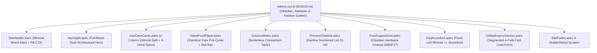

> **Archived planning document.** This describes an earlier iteration and is not current documentation. See the root `README.md`, `DESIGN.md` and `HANDOVER.md`.

# Implementation Plan: Minimalist Architectural Redesign & De-Carding

Transform the website from a templated "box-inside-a-box" layout into a **bespoke, minimalist architectural and engineering showcase**. Strip away card containers, reduce text density by 60%, introduce an **Obsidian (`#0B0F17`) & Alabaster (`#F7F7F5`)** palette, implement full-bleed dusk architectural visuals, and unify lead capture into a streamlined 4-field segmented interface.

---

## User Review Required

> [!IMPORTANT]
> **De-Carding 75%+ of the Site**: We are removing rounded card borders (`card`, `border`, `rounded-lg`, `shadow-sm`) from use cases, case studies, comparison tables, process steps, and FAQs. Sections will be structured using 1px hairline dividers (`border-t`, `border-b`) and expansive vertical whitespace (`clamp(5rem, 8vw, 8rem)`).

> [!IMPORTANT]
> **Streamlined 4-Field Form with Segmented Control**: The separate 10-field assessment form and 5-field advertiser module will be unified into a single clean container featuring a top toggle: `[ Request Site Assessment ]` vs `[ Advertise on Network ]`. The primary assessment form is cut down to 4 essential fields:
> 1. Full Name
> 2. Property Name & Location
> 3. Property Category (Estate / Mall / Commercial)
> 4. Phone & Email (2-column row)
> + 1 optional single-line note.

> [!NOTE]
> **Visual & Color Palette Shift**: Retiring default SaaS blue (`#2463B8`) in favor of **Architectural Obsidian (`#0B0F17`)**, **Warm Alabaster (`#F7F7F5`)**, crisp monochrome buttons, and precision electric cyan (`#38BDF8`) for active technical indicators. The 3-Layer Display Architecture section will sit on deep Obsidian to visually anchor the hardware engineering.

---

## Proposed Architectural Flow



---

## Proposed Changes

### Component 1: Design System & Tokens (`DESIGN.md` & `tokens.css`)

#### [MODIFY] `DESIGN.md`
- Update design philosophy to **Architectural Engineering Minimalism**.
- Define new core palette:
  - Surface Primary: `#FFFFFF`
  - Surface Stone / Alabaster: `#F7F7F5`
  - Surface Obsidian / Chassis: `#0B0F17`
  - Text Primary: `#0B0F17` (near black, ultra-sharp)
  - Text Secondary: `#525866` (muted slate)
  - Hairline Divider: `#E5E7EB` / `rgba(0, 0, 0, 0.08)`
  - Dark Hairline: `#1E2533`
  - Interactive: Monochrome black buttons with white text, electric cyan `#38BDF8` active indicators.
- Set typography rules: `h2` font-weight 500/600, letter-spacing `-0.03em`, remove redundant 3-line intro paragraphs under titles.
- Set section vertical whitespace to `clamp(5rem, 8vw, 8rem)`.

#### [MODIFY] `src/styles/tokens.css`
- Update CSS custom properties for Obsidian, Alabaster, and Hairline dividers.
- Remove heavy card container styles (`.card`, `.shadow-card`, rounded badges).
- Add minimal utility styles: `.hairline-divider`, `.editorial-quote`, `.stat-bar`, `.segmented-control`.

---

### Component 2: Top Navbar & Hero Section

#### [MODIFY] `src/components/SiteHeader.astro`
- **Mobile**: Minimalist brand wordmark on the left + clean "Book Assessment" pill button and 2-line menu toggle on the right.
- **Desktop**: Uncluttered navigation with ample spacing, subtle hairline bottom border.

#### [MODIFY] `src/components/HeroSplit.astro`
- Full-bleed dusk architectural hero showing an LED display integrated into gatehouse/commercial architecture at twilight.
- Direct, bold typography:
  - Single `<h1>`: `Installed LED Displays for Architecture & Property`
  - 1-line subtext: *"Turnkey digital infrastructure for South African residential estates and commercial precincts."*
  - Single primary CTA button: *"Book On-Site Assessment"* + subtle secondary jump link.
  - Eliminate the 3 bloated trust boxes and white container.

---

### Component 3: Use Cases & Case Study

#### [MODIFY] `src/components/UseCaseCards.astro`
- Remove all card boxes and 8 checkmark paragraphs.
- Clean editorial 2-column split:
  - **Residential Estates & HOAs**: High-contrast architectural visual + 3 crisp four-word specs:
    - *Gatehouse Access & Security*
    - *Dark-Sky Nuisance Compliant*
    - *STSMA PMR 29(2) Approved*
  - **Commercial Precincts**: High-contrast atrium visual + 3 crisp four-word specs:
    - *Atrium & Façade Presence*
    - *3,840Hz Camera-Safe Display*
    - *Non-GLA Media Revenue*
  - Separated by a 1px vertical hairline divider.

#### [MODIFY] `src/components/VideoProofPlayer.astro`
- Remove the 3 vertically stacked white quote boxes.
- Pair the 16:9 video player directly with:
  - **Standout Editorial Pull-Quote (24px)**:
    *"The gatehouse display transformed resident communications from cluttered temporary vinyl banners into an instant, unified architectural gateway."*
  - **Compact Horizontal Stat Bar**:
    `Location: Buh-Rein / George  ·  Enclosure: IP65 Outdoor  ·  Dimming: Auto Lux-Sensor  ·  Uptime: 99.9%`

---

### Component 4: Comparison & Process

#### [MODIFY] `src/components/SolutionMatrix.astro`
- Convert the 2 bulky cards and bottom summary box into a **borderless 2-column comparison table** with shared 1px horizontal rows:
  - Rows: *Primary Deployment*, *Peak Luminance*, *Optimal Viewing*, *Compliance Code*, *Commercial Model*.
  - Clean typographic presentation with zero card boxes.

#### [MODIFY] `src/components/ProcessTimeline.astro`
- Replace 4 floating white cards with a **minimalist numbered list (01 to 04)** separated by top hairline borders:
  - `01 / Feasibility`: Site sightlines, ambient solar audit, mounting substrate check.
  - `02 / Governance`: Scaled engineering drawings, SANS 10160 wind loading, PMR 29 board pack.
  - `03 / Installation`: Certified steel bracket mounting, concealed cabling, SANS 10142-1 CoC.
  - `04 / Handover`: Cloud 4G CMS setup, staff training, and maintenance SLA.
- Delete all sub-bullet lists and blue badge pills.

---

### Component 5: System Architecture & FAQ

#### [MODIFY] `src/components/TrustSupportGrid.astro`
- Visual contrast break: Place this section on a sleek **Obsidian hardware chassis background (`#0B0F17`)**.
- 3 columns separated by dark hairline dividers (`border-neutral-800`):
  - *Layer 01 / Cloud CMS*: Web portal with role-based access, emergency override, and scheduled playlists.
  - *Layer 02 / Edge Controller*: Industrial 4G player with local SSD cache and real-time lux-sensor dimming.
  - *Layer 03 / Modular Chassis*: Marine-grade IP65 aluminium cabinets built for coastal humidity and load-shedding surges.
- Clean 2-line descriptions with zero card borders.

#### [MODIFY] `src/components/FaqAccordion.astro`
- Remove all rounded floating boxes and "Q" badge icons.
- Flush-left questions separated only by 1px bottom hairline dividers.
- Clean `+` / `−` icon on the right with smooth toggle.

---

### Component 6: Unified Conversion Funnel & Footer

#### [MODIFY] `src/components/PropertyQuoteForm.astro` -> Unified Inquiry Component
- Replace the separate "What Site Assessment Covers" box, 10-field quote form, and separate 5-field advertiser box.
- Unified interface with a top **Segmented Control**:
  `[ Request Site Assessment ]`  |  `[ Advertise on Network ]`
- **Assessment Form cut to 4 essential fields**:
  1. Full Name
  2. Property Name & City
  3. Category Selector (`Estate` / `Mall` / `Commercial` / `Other`)
  4. Phone & Email (2-column row)
  + 1 optional single-line note.
- **Advertising Form**:
  1. Contact Name
  2. Business / Brand Name
  3. Phone & Email (2-column row)
  4. Campaign Notes
- Retains full server-side validation, anti-bot honeypot, speed trap, and SA phone normalisation (`+27`, `0`, hybrid).

#### [MODIFY] `src/pages/index.astro`
- Update page assembly to reflect the streamlined, de-carded layout.

---

## Verification Plan

### Automated Tests
```bash
# 1. Typecheck and linting
npm run build

# 2. Run form submission tests (FT-01 to FT-06)
HOST=127.0.0.1 PORT=4321 node ./dist/server/entry.mjs &
# Verify both form branches under the unified endpoint
```

### Manual & Ergonomics Verification
1. **De-Carding Audit**: Verify that at least 75% of sections are free of rounded card borders, using clean 1px hairline dividers instead.
2. **Visual Rhythm**: Confirm the transition from light Alabaster to dark Obsidian (`#0B0F17`) in the 3-Layer Display Architecture section provides visual contrast without jarring.
3. **Form Segmented Control**: Verify switching between *"Request Site Assessment"* and *"Advertise on Network"* toggles smoothly and validates the 4 streamlined inputs.
4. **Mobile Navbar & Sticky CTA**: Test mobile viewport (< 768px) to verify clean header pill CTA, 2-line menu toggle, and auto-hiding sticky bar.
