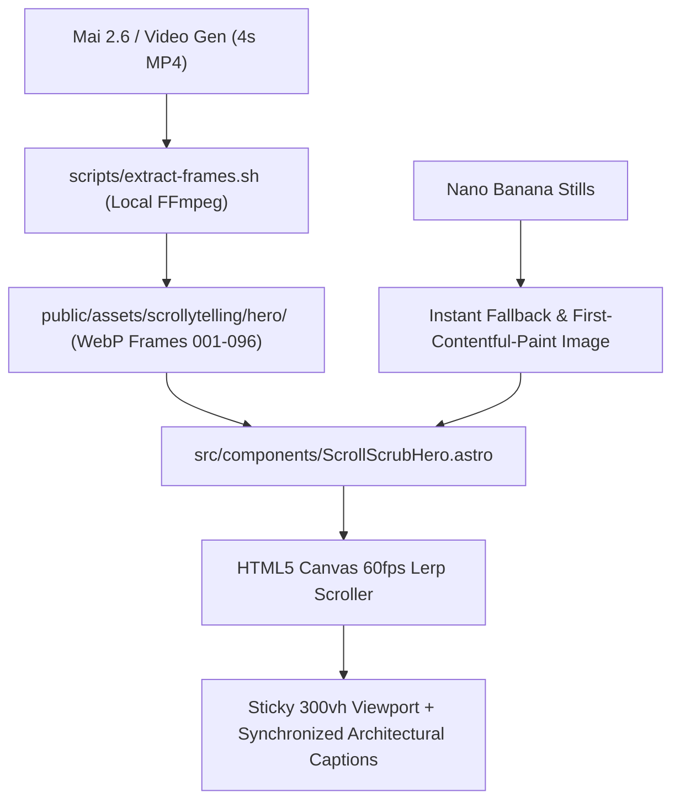

# Implementation Plan: Cinematic Motion & Scroll-Driven Canvas Architecture

**Project**: Vanguard Architectural Displays (`LED`)  
**Objective**: Build a high-performance, Apple-grade scroll-driven motion experience using **Nano Banana** architectural stills and **Mai 2.6** video generation, powered by a local 60fps canvas scrub engine.  
**Strict Directives**: 100% white-label (zero OEM/supplier mentions), zero mobile horizontal overflow, zero recurring credit costs.

---

## 1. Executive Summary & Creative Vision

Rather than relying on proprietary cloud tools like Higgsfield or heavy `<video>` elements that stutter when scrubbed on mobile devices, this architecture uses the **Awwwards / Apple product-reveal pattern**:
1. **Mai 2.6** generates a 4-second cinematic camera move (villa push-in as the LED display powers up).
2. **Local FFmpeg** (already installed in your Termux environment) slices the video into 72–96 lightweight, high-DPI WebP frames.
3. An Astro **HTML5 Canvas component** preloads the frames and scrubs them at a buttery **60 frames per second** locked to the user's scroll position.
4. **Nano Banana** architectural stills provide instant first-frame fallbacks, high-DPI static backgrounds, and exploded hardware detail views.



---

## 2. Technical Architecture: Why Canvas Scrub Outperforms Video Elements

| Feature | Raw `<video.currentTime>` Scrub | Canvas Frame Sequence (Our Plan) |
| :--- | :--- | :--- |
| **Mobile Safari & Chrome Scrub** | Stutters heavily (5–10 fps) due to GOP keyframe decoding delay. | **Buttery-smooth 60 fps** via pre-decoded image cache. |
| **Reverse Scrolling** | Major latency and frame drops when scrolling backwards. | **Instant 0ms seek** in both directions. |
| **Battery & GPU Usage** | High (continuous hardware video decoder restart). | **Low** (simple 2D canvas `drawImage`). |
| **Bandwidth Optimization** | Must load entire 20–50MB MP4 before reliable seeking. | **Progressive loading** (first 15 frames load in < 400ms; remaining stream in background). |
| **Reduced Motion / Low Power** | Hard to gracefully degrade without custom code. | Clean fallback to static Nano Banana still on `prefers-reduced-motion`. |

---

## 3. Viewport Geometry & Scroll Choreography

### A. The 300vh Sticky Track
* **Outer Container (`.hero-scroll-track`)**: `height: 300vh;`  
  Provides 3 full screen viewports of scroll travel distance, giving the user precise, deliberate control over the camera glide.
* **Sticky Stage (`.hero-sticky-stage`)**: `position: sticky; top: 0; height: 100vh; width: 100%; overflow: hidden;`  
  Locks to the viewport while the user scrolls through the 300vh track.
* **Responsive Canvas (`<canvas id="hero-scrub-canvas">`)**:  
  Auto-scales using `devicePixelRatio` to prevent blurriness on Retina/OLED mobile screens while cropping cleanly with an `object-fit: cover` algorithm.

### B. Synchronized 3-Beat Narrative Captions
As the canvas scrubs from frame 1 to 96, text cards smoothly fade in and out at key milestones:

```
Scroll 0% ──────────────── 30% ──────────────── 65% ──────────────── 100%
[ Beat 1: Brand ]      [ Beat 2: Hardware ]   [ Beat 3: Environment ]
"Vanguard Architectural   "Monolithic Seamless    "Engineered for African
 Displays — The           Integration. Up to      Sun & Coastal Weather.
 Engineering of Light"    10,000 Nits."           Turnkey Custody."
```

* **Beat 1 (0% – 28% scroll)**: Display is in standby; text introduces the architectural brand and bespoke engineering.
* **Beat 2 (32% – 62% scroll)**: As the screen in the video powers up and illuminates the villa terrace, headline highlights 10,000-nit true-black contrast and bezel-free golden ratio cabinets.
* **Beat 3 (66% – 95% scroll)**: Full brilliance reached; CTA pill triggers smooth scroll directly to Consultation Form (`#quote-form`) or Specification Matrix (`#matrix`).

---

## 4. Phase-by-Phase Implementation Roadmap

### Phase 1: Tooling & Frame Extraction Pipeline
* **File**: `scripts/extract-frames.sh`
* **Tasks**:
  1. Create a lightweight bash script in `scripts/extract-frames.sh` that takes any input MP4 (from Mai 2.6), rescales to 1920x1080 (and 960x540 for mobile), and outputs numbered WebP frames (`frame_001.webp` ... `frame_096.webp`) with quality 85.
  2. Add npm script: `"extract-frames": "bash scripts/extract-frames.sh"`.
  3. Include a fallback generator script that creates a smooth placeholder gradient/architectural frame series so the canvas scroller works and can be tested immediately, even before the user generates the final Mai 2.6 video.

### Phase 2: Building `ScrollScrubHero.astro`
* **File**: `src/components/ScrollScrubHero.astro`
* **Tasks**:
  1. Construct semantic HTML: sticky 300vh container, full-bleed `<canvas>`, and accessibility-first live region overlay.
  2. Implement zero-dependency client script:
     - `imagePool` array preloading first 15 frames immediately, lazy-loading the rest via idle callback.
     - `requestAnimationFrame` loop with linear interpolation (`lerp(currentProgress, targetProgress, 0.08)`) to eliminate touch-scroll jitter.
     - Canvas responsive aspect-ratio cover math: preserves center composition on both ultrawide desktop (21:9) and tall mobile (9:19.5).
     - Strict `min-width: 0` and `max-width: 100%` constraints to guarantee **zero mobile horizontal overflow**.
  3. Accessibility:
     - Check `window.matchMedia('(prefers-reduced-motion: reduce)')`. If enabled, skip animation and display the static Nano Banana render with standard typography.

### Phase 3: Seamless Integration into Homepage (`src/pages/index.astro`)
* **Files**: `src/pages/index.astro`, `src/config/site.ts`
* **Tasks**:
  1. Replace or enhance `HeroSplit.astro` with `ScrollScrubHero.astro`.
  2. Ensure all navigation anchor links (`/#hero`, `/#use-cases`, `/#featured-project`, `/#matrix`, `/#quote-form`) remain 100% intact.
  3. Seamless bottom transition: as the user scrolls past 300vh, the sticky stage naturally unpins, leading into Section 03 (`UseCaseCards.astro`).

### Phase 4: Integrating Nano Banana Stills into Remaining Sections
* **Target Locations**:
  - `UseCaseCards.astro`: High-res stills for **Residential Estates**, **Commercial Atriums**, and **DOOH Monoliths**.
  - `TrustSupportGrid.astro`: Exploded CNC aluminium chassis diagram with macro die-cast texture.
  - `about.astro`: Architectural workshop & George headquarters imagery.

### Phase 5: Verification, Performance & Build Audit
* **Tasks**:
  1. Run `npm run build` to verify 0 errors, 0 warnings across all routes.
  2. Test viewport widths: 360px (mobile), 768px (tablet), 1280px (laptop), 1920px (desktop).
  3. Memory safety check: verify canvas image buffers are garbage-collected properly without memory growth.
  4. White-label verification: `grep -ri "hikvision" src/ public/` must return 0 results.

---

## 5. Directory & Asset Structure

```
/data/data/com.termux/files/home/LED/
├── scripts/
│   ├── extract-frames.sh           # Automated FFmpeg video-to-WebP slicer
│   └── generate-demo-frames.mjs    # Instant mock frames for immediate testing
├── public/
│   └── assets/
│       ├── hero-fallback.webp      # Nano Banana high-DPI hero still
│       └── scrollytelling/
│           └── hero/
│               ├── frame_001.webp  # Sliced Mai 2.6 frames (001 to ~096)
│               ├── ...
│               └── frame_096.webp
└── src/
    └── components/
        └── ScrollScrubHero.astro   # 60fps canvas scroller component
```

---

## 6. User Action Items

1. **Review & Approve this Implementation Plan**.
2. **Generate Visuals at your convenience**:
   - Run **Video Prompt #1** in Mai 2.6 (or your external video tool) and save the 4-second `.mp4`.
   - Run **Image Prompts #1 & #2** in Nano Banana and save the high-res `.png` / `.webp`.
3. While you generate the assets, I will scaffold the extraction script, build `ScrollScrubHero.astro` with instant test frames, and prepare the engine so the moment you drop your files in, the live scrollytelling experience lights up immediately.
