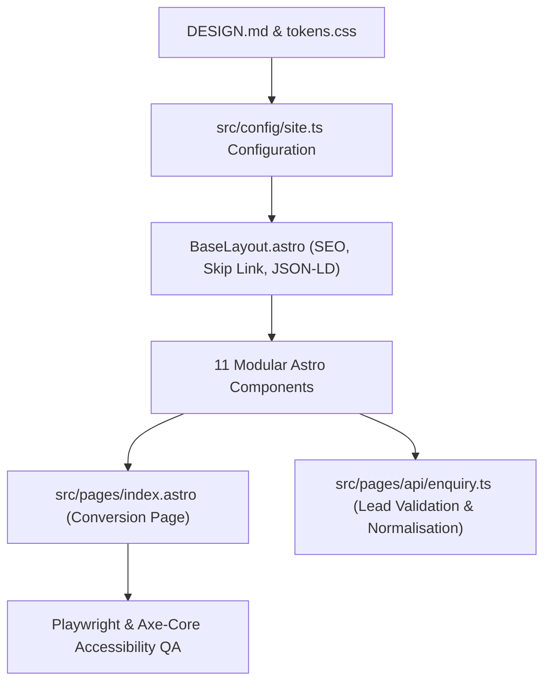

# Implementation Plan: Design Specification & Astro Project Scaffolding

Generate the foundational **`DESIGN.md`** visual design specification and scaffold the greenfield **Astro 5** project in `/data/data/com.termux/files/home/LED` adhering strictly to the **South African LED Website Blueprint** (October 2026).

---

## User Review Required

> [!IMPORTANT]
> **Greenfield Scaffolding**: The working directory `/data/data/com.termux/files/home/LED` is currently empty. We will initialize Git and install Astro 5 with TypeScript. No legacy code will be overwritten.

> [!NOTE]
> **Client Information Tokens**: As specified in Section 17 of the Blueprint, actual client identity (business name, phone, domain, email) will be cleanly abstracted inside `src/config/site.ts` using safe placeholders (`[Brand Name]`, `+27 (0)XX XXX XXXX`, etc.) so that the site is 100% functional immediately and can be branded in seconds once client details are signed off.

---

## Proposed Architectural Flow



---

## Proposed Changes

### Component 1: Design Specification (`DESIGN.md` & CSS Tokens)

#### [NEW] `DESIGN.md`
Creates the canonical design system specification in the repository root covering:
1. **Architectural Swiss-Grid Editorial Aesthetic**: Generous whitespace, structural hairline borders (`1px solid #E2E8F0`), tabular numerals for step numbering (`01`–`04`), and high contrast.
2. **Contrast-Verified Palette**:
   * `--color-bg-primary`: `#FFFFFF`
   * `--color-bg-subtle`: `#F8FAFC` (alternating section alabaster)
   * `--color-bg-tint`: `#EFF6FF` (active pill & callout tint)
   * `--color-bg-inverse`: `#202A36` (dark charcoal footer)
   * `--color-text-primary`: `#202A36` (14.52:1 contrast AAA on `#FFFFFF`)
   * `--color-text-secondary`: `#475569` (7.58:1 contrast AAA on `#FFFFFF`)
   * `--color-text-on-inverse`: `#FFFFFF` (14.52:1 contrast AAA on `#202A36`)
   * `--color-text-accent-inverse`: `#93C5FD` (7.85:1 contrast AAA on `#202A36` — avoids the 2.46:1 failure of `#2463B8` on charcoal)
   * `--color-brand-primary`: `#2463B8` (5.91:1 contrast AA on `#FFFFFF`)
   * `--color-brand-hover`: `#1D4ED8` (6.70:1 contrast)
   * `--color-border-subtle`: `#E2E8F0`
   * `--color-border-input`: `#64748B` (4.76:1 non-text contrast against `#FFFFFF`, passing WCAG 3.0:1)
   * `--color-focus-ring`: `2px solid #2463B8` (outline-offset: `2px`)
   * `--color-error`: `#B91C1C` (6.47:1)
   * `--color-success`: `#15803D` (5.02:1)
3. **Typography & Fluid Hierarchy**:
   * Font families: System sans (`Inter`, `-apple-system`, `BlinkMacSystemFont`, `'Segoe UI'`, `Roboto`) + Monospace (`'JetBrains Mono'`, `ui-monospace`)
   * `h1`: `clamp(2.125rem, 3.5vw + 1rem, 3.25rem)` (line-height: 1.12)
   * `h2`: `clamp(1.625rem, 2.2vw + 0.8rem, 2.25rem)` (line-height: 1.2)
   * `body`: `1.0625rem` (17px), max line width 65ch
   * `inputs/selects`: minimum `1rem` (16px) to eliminate iOS Safari automatic zoom
4. **Touch & Ergonomics (WCAG 2.2 AA)**:
   * Target sizing $\ge 44 \times 44\text{ CSS px}$
   * Global `scroll-padding-top: 88px` and `scroll-padding-bottom: 80px` on `<html>`
   * `@media (prefers-reduced-motion: reduce)` rules for all transitions

#### [NEW] `src/styles/tokens.css`
Exports all CSS custom properties and utility classes based directly on `DESIGN.md`.

---

### Component 2: Project Setup & Configuration Abstraction

#### [NEW] `package.json`
Initializes dependencies:
* `astro` (^5.0.0)
* `typescript` (^5.5.0)
* `@types/node`
* Scripts: `dev`, `build`, `preview`

#### [NEW] `astro.config.mjs`
Configures Astro with:
* Static generation (`output: 'static'`)
* Strict trailing slash / canonical handling
* Serverless endpoint compatibility

#### [NEW] `tsconfig.json`
Strict TypeScript configuration matching Astro recommendations (`astro/tsconfigs/strict`).

#### [NEW] `src/config/site.ts`
Centralized configuration isolating client unknowns:
```typescript
export interface SiteConfig {
  brand: {
    name: string;
    legalName: string;
    tagline: string;
    establishedYear: number;
    headquarters: string;
  };
  contact: {
    phoneDisplay: string;
    phoneDial: string;
    whatsappNumber: string;
    emailQuote: string;
    emailAdvertise: string;
    operatingHours: string;
  };
  coverage: {
    primaryHub: string;
    regionalCoverage: string[];
    nationalProjectsNotice: string;
  };
  featuredProject: {
    title: string;
    location: string;
    anonymizedEstateLabel: string;
    videoPoster: string;
    videoSrc: string;
  };
}
```

---

### Component 3: Base Layout & SEO Schema

#### [NEW] `src/layouts/BaseLayout.astro`
* Accessible skip link: `<a href="#main-content" class="skip-link">Skip to main content</a>`
* Semantic `<head>` with title: `LED Screen Supply & Installation South Africa | [Brand Name]` (59 characters)
* Meta description (156 characters)
* OpenGraph & Twitter cards
* Inlined JSON-LD Structured Data:
  * `schema.org/Organization`
  * `schema.org/Service` (`serviceType: "LED Display Supply and Installation"`, `areaServed: "South Africa"`)
  * `schema.org/VideoObject` (for George project video)

---

### Component 4: 11 Modular UI Components

Files created under `src/components/`:
1. **`SiteHeader.astro`**: Accessible navigation, brand mark, anchor links with hover/focus indicators, primary CTA *"Request a Site Assessment"*.
2. **`HeroSplit.astro`**: Concept A layout: Eyebrow badge, semantic `<h1>`, value proposition subheadline, primary + secondary CTAs, 3 proof pills, and high-priority WebP architectural visual.
3. **`UseCaseCards.astro`**: Dual-column architectural cards comparing Residential Estates/HOAs (security notices, municipal outages, AGM updates, zero fan noise, PMR 29 governance) vs. Shopping Centres/Commercial Precincts (high footfall, retail atriums, tenant promotions, DOOH readiness).
4. **`VideoProofPlayer.astro`**: Section 4 George flagship project. Inline poster-led HTML5 `<video>` player (`controls`, `preload="none"`, WebP poster, closed captions, transcript) + 3 structured proof cards (Property Brief, Sightline & Mounting Execution, Daily Operational Outcome).
5. **`SolutionMatrix.astro`**: Side-by-side comparison matrix for Outdoor Weatherproof displays ($5,500\text{–}10,000\text{ nits}$, IP65/IP67, auto-dimming) vs. Indoor Fine-Pitch screens ($600\text{–}800\text{ nits}$, fanless, seamless bezel-free) + consultation callout explaining viewing distance vs. pixel pitch.
6. **`ProcessTimeline.astro`**: 4-stage transparent project roadmap (01 Feasibility Assessment $\rightarrow$ 02 Engineering Scope & Board-Ready Quote $\rightarrow$ 03 Turnkey Installation $\rightarrow$ 04 Handover & Training).
7. **`TrustSupportGrid.astro`**: 3-layer operational architecture (Cloud CMS, Edge Playback with lux sensors, Modular LED hardware) + 3 reassurance cards (Simple Content Updates, Engineered for SA Conditions, Transparent Coverage).
8. **`FaqAccordion.astro`**: 6 native `<details>/<summary>` accordions resolving final objections prior to booking.
9. **`PropertyQuoteForm.astro`**: Primary conversion funnel. 2-column layout (left: assessment checklist + direct phone/WhatsApp; right: 8 required fields with 4-pill selectors for property type & environment, including *"Unsure — Advise Me"*, plus optional notes). Includes client-side SA phone formatting and POPIA compliance disclosure.
10. **`AdvertisingEnquiryForm.astro`**: Section 10 isolated media-buying module with compact 5-field form.
11. **`SiteFooter.astro`**: Dark `#202A36` background with accessible `#FFFFFF` and `#93C5FD` interactive elements, statutory disclosures, PAIA notice modal link, and copyright.
12. **`MobileStickyCta.astro`**: Sticky bottom bar on mobile (<768px) with `IntersectionObserver` that automatically hides when `#quote-form` or `#advertise` is in view to satisfy WCAG 2.2 SC 2.4.11.

---

### Component 5: Landing Page Assembly & API Pipeline

#### [NEW] `src/pages/index.astro`
Assembles all 11 sections sequentially into the unified, high-converting B2B landing page.

#### [NEW] `src/pages/api/enquiry.ts`
Hybrid server-side form handler (`export const prerender = false`):
* Honeypot inspection (`company_website_url`)
* Submission speed threshold validation ($> 2.5\text{s}$)
* South African phone normalisation (`/^(?:\+27|27|0)[1-8][0-9]{8}$/` after stripping delimiters)
* Dual-channel dispatch simulation/logging (email notification + durable backup store payload)
* Graceful fallback payload returning pre-filled WhatsApp and mailto links if needed.

---

## Verification Plan

### Automated Verification
```bash
# 1. Typecheck and linting
npm run build

# 2. Start local preview server
npm run preview
```

### Manual & Ergonomics Verification
1. **WCAG 2.2 Contrast Verification**: Verify contrast across light sections and dark footer.
2. **Form Interaction & Phone Normalisation**: Test `082 782 4346`, `+27 (0)44 801 9122`, and mobile 10-digit formats.
3. **Mobile Sticky Bar Behavior**: Scroll down on mobile viewports (<768px) to verify the sticky bar auto-hides when `#quote-form` or `#advertise` enters view.
4. **Video Player**: Confirm video does not auto-download or auto-play; verify poster frame and controls.
